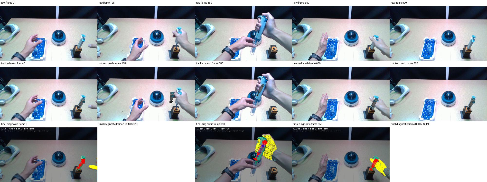
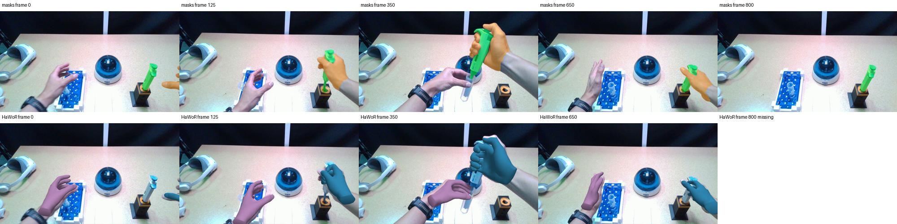

# Reconstruction pipeline, latest-run review, and known-scene integration plan

Reviewed: 2026-10-28 (Asia/Taipei).

This document records the current implementation and the latest-run review, then proposes an implementation plan for using a supplied pipette mesh and the `lidar` simulation environment without pre-existing camera calibration. The proposed integration has not been implemented or evaluated. No reconstruction was rerun for this review.

Reviewed checkouts:

- `do-as-i-do`: HEAD `824591b`; findings describe the local working tree, which contains modifications beyond HEAD.
- `../g1-pipette-sim`: HEAD `fc79e2b`.
- `../g1-wuji-retargeting`: HEAD `fa3f943`.

## 1. Current reconstruction pipeline

Entry point: [`run_pipeline.sh`](../run_pipeline.sh). Paths and environments: [`config/paths.sh`](../config/paths.sh).

```text
RGB video + reference frame + object name + anchor hand
  → frame extraction
  → SAM3 object and anchor-hand masks
  → reference SAM-3D object mesh and pose
  → reference MoGe intrinsics → HaWoR hand reconstruction
  → per-frame MoGe pointmaps + GeoCalib gravity
  → TAPIR image-plane motion
  → bidirectional, fixed-shape Fast-SAM3D pose tracking
  → projection diagnostics + camera-frame conversion
  → hand-based global mesh scaling and per-frame translation scaling
```

The operative assumptions are a static camera, a rigid object shape, one reference reconstruction, and a hand-derived metric scale. This is a sequence of separate estimators, not joint scene/hand/object reconstruction.

### Inputs, execution, and resumption

The CLI is `VIDEO_PATH [FRAME_N] [OBJECT] [ANCHOR_HAND]`, with defaults `28`, `pan`, and `right`. It accepts one object name even though the shell loops over an array. Frames are numbered from zero. A full run writes `config.json` beside the video. The shell arguments, rather than reading this JSON back, control resumed runs.

Four conda environments are used: `sam3`, `sam3d-objects`, `hawor`, and `tapnet`. GPU 0 is selected by the paths configuration. Supported `START_STAGE` values are `0`, `2`, `hawor`, `pointmaps`, and `4`. Resumption checks artifact existence, not provenance or consistency with changed settings. HaWoR also reuses some cached detection and inference artifacts internally.

### Stage 0–1: extraction and segmentation

FFmpeg extracts all frames to `all_frames/%06d.png` and a separate reference image such as `0125.png`. SAM3 uses interactive positive/negative clicks for the object and a text prompt such as `right hand` for the anchor hand. Propagation runs both directions from the prompt frame.

The script saves the highest-scoring returned mask separately at each frame; missing detections become empty masks. Masks live at `video_segmentation/masks/frame_XXXXXX_masks/<object>.png`. It also saves overlay videos. The shared overlays image directory can be overwritten by subsequent segmentation calls; the separately named videos and masks are the useful stage records.

Source: [`run_sam3_video.py`](../scripts/run_sam3_video.py).

### Stage 2: reference geometry, hands, depth, gravity

SAM-3D Objects generates geometry from the reference image and masks: MoGe pointmap, sparse structure and pose, structured latent generation, mesh decoding, mesh postprocessing, texture baking, and layout refinement. It writes a canonical textured OBJ and `layout.json` in the reference masks directory.

The launcher invokes generation on every PNG mask in that directory, including the anchor-hand mask. That generated hand mesh is distinct from HaWoR and is not the hand used for final scale calibration.

A separate MoGe pass saves the reference pointmap and pixel intrinsics; only reference `fx` is passed to HaWoR. HaWoR runs its own detection/tracking, motion estimation, infilling, and MANO reconstruction for both hands. `--static_camera` disables SLAM. The archive `<video_name>/all_hand_meshes.npz` contains vertices, joints, MANO parameters, and validity flags.

MoGe subsequently processes all frames independently, saving one pointmap and one 3×3 intrinsics matrix per frame. GeoCalib processes the frames, rejects angular outliers with a median-absolute-deviation rule, and computes a confidence-weighted mean direction. Its `gravity.json` is consumed downstream by retargeting, not by the reconstruction pose fitter.

Sources: [`generate_mesh_sam3d.py`](../modules/sam-3d-objects/generate_mesh_sam3d.py), [`HaWoR/demo.py`](../modules/HaWoR/demo.py), [`get_pointmap_dir.py`](../scripts/get_pointmap_dir.py), [`predict_video_gravity.py`](../scripts/predict_video_gravity.py).

### Stage 2.5: TAPIR

The script first produces a full-video tracking visualization. A separate adjacent-frame pass supplies the statistics used by reconstruction. It samples 20 object-mask points, tracks at 256×256, requires at least five correspondences visible in both frames and consistent with the next mask, and fits a 2D rigid transform by SVD. Failed estimates are interpolated when possible.

Only the absolute 2D rotation increment is consumed by the 3D tracker:

```text
pose_guidance = max(0.1, 0.7 - 0.09 * abs(rotation_degrees_per_frame))
```

The fallback is 0.5. TAPIR does not directly supply the 3D trajectory; its translation estimates are not used for pose prediction.

Source: [`tapir_velocity_tracking.py`](../scripts/tapir_velocity_tracking.py).

### Stage 3: fixed-shape object tracking

The reference mesh is voxelized. The installed Fast-SAM3D pipeline configuration lacks a configured sparse-structure encoder, so shape encoding falls back to 1,000 steps of decoder inversion. The tracker loads the reference pose from the reference `layout.json`.

Tracking goes backward from reference−1 to the first available frame, then restarts at the reference and goes forward. Each frame recomputes MoGe internally; saved pointmaps are not reused in this stage.

| Setting | Active launcher value |
|---|---|
| Shape guidance | 1.0 |
| Pose candidates | 25, in chunks of 8 |
| Euler steps | 25 |
| Scale | Fixed to reference scale |
| Scoring | Rendered silhouette IoU |
| Selection | Largest qualifying pose cluster, then highest IoU within it |
| Clustering | Distance 0.3; minimum size 3; translation weight 1; rotation weight 1.5 |
| Pose chaining | Selected diffusion pose before post-optimization |
| Post-optimization | Selected candidate only |
| Shape/visible ICP | Disabled |
| Acceleration | Sparse-structure cache and torch.compile |

Cluster size takes precedence over mean score; if none satisfies minimum size, smaller clusters are allowed. Post-optimization aligns to masked MoGe points and refines rendered silhouette alignment with fixed scale. Export prefers the post-optimized pose, with a diffusion fallback for invalid post-fit values. Chaining uses the pre-post-fit diffusion pose. Both are stored in the combined layout.

Empty-mask frames are omitted, retaining the previous chain target. No camera extrinsics are supplied to compensate for camera motion. Per-frame candidate files and `guided_poses.pt` preserve diagnostics.

Source: [`track_object.py`](../modules/Fast-SAM3D/track_object.py).

### Stage 3–4: coordinate conversion and hand-based calibration

Mesh projection diagnostics are rendered before final hand-based calibration. Conversion adds camera-frame translations and wxyz quaternions, with x right, y down, z forward, while preserving original fields.

Final calibration raycasts through anchor-hand mask pixels onto the HaWoR hand surface. The ratio of mean hand-surface depth to MoGe depth at corresponding pixels supplies a reference scale `k_ref`. The optimizer uses it for one global object mesh scale and working translations.

Per frame, the target is:

```text
object_target = HaWoR_hand_centroid
              + k_frame * (MoGe_object_centroid - MoGe_hand_centroid)
```

With rotated mesh centroid `c`, working translation `t`, and target `o`, it solves:

```text
s = dot(t, o - c) / dot(t, t)
translation_final = s * t
```

Rotation is unchanged. This is a scalar translation adjustment along the existing direction, not a free XYZ optimization. Object centroid filtering uses projected mesh vertices inside the mask, not a true visible-surface raycast. HaWoR validity flags are not used here. There is no temporal loss, collision loss, or hand-contact optimization. Smoothing and the interactive viewer are commented out; final diagnostic images are enabled automatically.

Sources: [`convert_layout_to_camera_frame.py`](../scripts/convert_layout_to_camera_frame.py), [`optimize_translation_scale.py`](../scripts/optimize_translation_scale.py).

### Final data contract and known issues

Outputs include the reference OBJ, hand archive, gravity, and:

```text
obj_tracking_out/<object>/combined_visualization/
  layout.json
  layout_camera_frame.json
  layout_camera_frame_optimized.json
```

Downstream consumers use `translation_camera_frame`, `quat_wxyz_camera_frame`, and `translation_scale_optimization.mesh_scale`.

**Confirmed bug:** the optimizer rescales translations in its working frame list but creates output by copying the original layout. Only successfully fitted frames receive updated translations. Skipped frames retain uncalibrated translations alongside the globally calibrated mesh scale.

Other caveats: full runs can reconstruct an unnecessary SAM-3D hand; MoGe is repeated in separate stages; diagnostic video rates differ (SAM3 24, TAPIR 10, hand/object rendering 30 FPS); resumption can reuse stale artifacts; wholly unsuccessful TAPIR statistics can retain null rotations that the tracker does not guard before `abs()`.

## 2. Latest completed run: pipette_g1_01

Selection is based on the final optimized layout modification time (October 10), not parent-directory timestamps. Older `pipette_01` has later diagnostic activity. The reviewed source is `pipette_g1_01_trimmed.mp4`: 817 frames, 1280×720, 30 FPS, approximately 27.2 seconds. Reference frame: 125. Anchor: right hand.

The review inspected saved numerical outputs and representative images at frames 0, 125, 350, 650, and 800. It did not inspect every frame visually or compare to ground truth.

### Intermediate artifacts

Paths below are relative to this document and point into the existing run.

| Stage | Available result |
|---|---|
| Source frames | [817 images](../pipette_g1_01/all_frames) |
| Object segmentation | [Object-mask video](../pipette_g1_01/video_segmentation/tracked_pipette_click.mp4) |
| Anchor segmentation | [Right-hand-mask video](../pipette_g1_01/video_segmentation/tracked_right_hand_0_right_hand.mp4) |
| Reference mesh | [OBJ](../pipette_g1_01/video_segmentation/masks/frame_000125_masks/pipette/pipette.obj), adjacent MTL/texture, [layout](../pipette_g1_01/video_segmentation/masks/frame_000125_masks/layout.json) |
| Depth/intrinsics | 817 pointmaps and 817 intrinsics arrays in `all_frames`; no depth movie |
| Hands | [NPZ](../pipette_g1_01/pipette_g1_01_trimmed/all_hand_meshes.npz), [763 preview images](../pipette_g1_01/pipette_g1_01_trimmed/vis_0_817/aitviewer/images/rgb); no encoded hand movie in this run |
| Gravity | [gravity.json](../pipette_g1_01/gravity.json) |
| TAPIR | [Tracks video](../pipette_g1_01/output_tapir_pipette.mp4), [motion chart](../pipette_g1_01/output_tapir_pipette_motion.png), [816 pair previews and statistics](../pipette_g1_01/perframe_tracking_pipette) |
| Object tracking | [Projected video](../pipette_g1_01/obj_tracking_out/pipette/combined_visualization/projected/video.mp4), [candidate files](../pipette_g1_01/obj_tracking_out/pipette) |
| Final calibration | [678 diagnostic images](../pipette_g1_01/obj_tracking_out/pipette/combined_visualization/viz), [final JSON](../pipette_g1_01/obj_tracking_out/pipette/combined_visualization/layout_camera_frame_optimized.json) |





### Findings

- Sampled segmentation is broadly plausible. At frame 800 the pipette remains segmented and the anchor-hand mask is empty.
- The generated object shape does not fully match the real pipette. At reference frame 125 its projected mesh is visibly displaced from the object. A supplied mesh improves shape fidelity only if the reference pose is also corrected.
- Sampled HaWoR previews broadly follow the hands; this does not establish contact or depth accuracy. The archive has 817 hand frames, while only 763 rendered previews are present. Missing previews do not imply missing hand arrays.
- TAPIR records `ok` for all 816 frame pairs. This establishes coverage, not 3D accuracy.
- GeoCalib retains 589/817 frames, with aggregate roll approximately 2.31° and pitch −35.78°.
- Final calibration succeeds on 678/817 poses and skips 139: frames **3–9, 125, and 686–816**. The absent hand in the late sequence is consistent with failure of hand anchoring, but individual skip reasons were not reconstructed from a retained log.
- All 139 skipped translations exactly match the pre-calibration layout. The global reference scale factor is approximately **0.502879**, making the mixed scale conventions material.
- Final global mesh scale is approximately **0.127402**. Successfully fitted translation multipliers range from **0.0768 to 1.1205**, median **0.7077**.
- Median internal target residual decreases from **0.18199 to 0.01250**, in the reconstruction's hand-based coordinate units. This is agreement with the derived target, not a ground-truth error metric.

For comparison, `pipette_01` has 349/349 successfully calibrated poses, and the saved `whisking` result has 138/138. These counts alone do not establish visual or metric accuracy.

## 3. Review of the newly cloned repositories

Repository paths use hyphens: `g1-pipette-sim` and `g1-wuji-retargeting`.

### Where the environment actually lives

In these checkouts, **lidar is owned by g1-pipette-sim**, not g1-wuji-retargeting:

- [Environment description](../../../g1-pipette-sim/ENVIRONMENTS.md).
- [Raw scene XML](../../../g1-pipette-sim/assets/environments/lidar/scene.xml).
- [Export manifest](../../../g1-pipette-sim/assets/environments/lidar/manifest.json).
- [Runtime calibration](../../../g1-pipette-sim/config/environments/lidar-scene.json).
- [Scene loader and transforms](../../../g1-pipette-sim/g1_pipette_sim/environments/__init__.py).
- [Physical scene builder](../../../g1-pipette-sim/g1_pipette_sim/environments/physical.py).

The clean scene contains a table, pipette, stand, pin rack, open benchtop instrument, cylinder, and cylinder base. The raw room scan is excluded. It is modeled geometry, not a validated reconstruction of every visible surface.

Runtime applies **uniform scale 0.5** plus a vertical floor offset. Raw pipette height is 0.508 m; the measurement anchor is 0.254 m (10 inches). The resulting table is approximately 0.768×1.536×0.720 m. The configuration explicitly states that placement remains approximate and needs session-specific validation. Loading the raw XML or raw OBJ directly bypasses these transforms.

The source bodies have no explicit placement positions in the raw XML; geometry carries the exported placement. Do not assume a source mesh is already centered in a useful tool frame. Export calibrated assembled visual geometry and explicitly record a canonical-object-to-scene transform.

The physical variant makes `env_01_pipette` and `env_02_cylinder` free bodies and uses collision proxies. Rendering/registration should use visual geometry; physics validation should use collision geometry. Robot replay initialization and camera overview settings are not calibration for this human demonstration.

### Two pipette asset paths must not be confused

1. The lidar scene already includes an assembled modeled pipette with metric scaling applied at runtime.
2. [`tools/export_pipette_mesh.py`](../../../g1-pipette-sim/tools/export_pipette_mesh.py) exports the procedural/photo-refined task pipette to OBJ/MTL in metres and tool-local coordinates. It includes pipette and ejector at rest, optionally the detachable tip, and excludes group-3 collision proxies. Default configuration is `hil194.json`, which can require episode data to resolve a session profile.

The conventional output `outputs/pipette-photo-refinement/pipette.obj` is **not present in the clone**. The retargeting documentation describes that asset as roughly 25.4×63.5×254 mm, but that exported file was not available to measure. Its linked `docs/ONILAB_PIPETTE.md` is also absent in this checkout. Inspect the actual exported shape against this video's pipette before selecting either source; tip state matters.

The retargeting [preset](../../../g1-wuji-retargeting/retargeting/presets.py) hard-codes `g1_pipette_sim` with underscores. That does not match the local cloned directory. Prefer an explicit asset path in the integration rather than relying on that preset.

### Reusable calibration and registration code

The existing [camera calibrator](../../../g1-pipette-sim/g1_pipette_sim/calibrate_camera.py) solves fixed-camera PnP/RANSAC and refines it, but **requires a camera matrix supplied by the caller**. The [planar candidate utility](../../../g1-pipette-sim/tools/fit_ego_view_from_landmarks.py) also assumes known intrinsics and explicitly reports planar ambiguity. Existing robot-dataset camera configurations must not be copied to this video as if calibrated.

The retargeting repository has a [FoundationPose client](../../../g1-wuji-retargeting/retargeting/foundationpose.py), server, mesh fingerprint checks, and [offline track refinement](../../../g1-wuji-retargeting/retargeting/offline_registration.py). Its FoundationPose request includes RGB, **depth and K**. It is not a ready-to-run RGB-only, unknown-camera solution. The offline registration workflow also expects its capture/marker/glove data contract. Reuse conventions and components selectively, not its complete workflow unchanged.

## 4. Proposed integration without camera calibration

### Goal and boundaries

Estimate a static camera, session-specific scene placement, and a fixed-metric-scale pipette trajectory from the existing RGB video. Keep the current pipeline as a baseline. Do not assume that a simulator's default camera or original prop positions correspond to the recording.

Unknown calibration is not necessarily a blocker: known metric geometry and sufficiently informative image correspondences can constrain camera parameters. It is an identifiability issue, however. A single plane with unconstrained intrinsics is ambiguous; repeated frames from the same static camera do not add viewpoints. Approximate prop placement can be confused with camera error. Report alternatives and uncertainty rather than forcing a unique solution.

### Phase A — preserve the baseline and standardize assets

1. Keep the existing run immutable; write a new `known_scene` output tree with input hashes and settings.
2. Fix the skipped-frame scale bug for the legacy baseline, explicitly record per-frame status/reason, and preserve a consistent scale for skipped output. Add a targeted regression check covering valid and skipped frames.
3. Export the calibrated lidar visual scene and selected pipette to the reconstruction workspace. Avoid implicit decompression/writes in the sibling clone during inspection; the scene loader's `unpack_meshes()` can write there.
4. Record mesh units, bounds, origin, axes, source hash, visual/collision distinction, optional tip/ejector state, and the transform connecting canonical object coordinates to the imported scene.
5. Compare both candidate pipette models to clear video frames before committing. Remove the static duplicate pipette from environment rendering when inserting the tracked one.

Deliverable: `scene_manifest.json`, canonical `pipette.obj`/MTL, scene visual/collision assets, and a dimension/axis preview. No hidden recentering or rescaling.

### Phase B — estimate camera and register the scene

1. Verify the static-camera assumption using stationary scene features across the clip. Account for image cropping/resizing; use the actual 1280×720 image coordinates.
2. Select about 12–20 well-spread 2D/3D correspondences on recognizable static scene features: tabletop edges, stand corners, rack corners, instrument features. Prefer features at multiple heights. Avoid using the moving pipette or hands as static scene landmarks. A small manual landmark annotation step is appropriate.
3. Initialize a pinhole camera with zero skew, square pixels, centered principal point, and no distortion. Use existing MoGe focal estimates and GeoCalib orientation as initial guesses/weak priors, not ground truth. Search a range of focal lengths and camera poses instead of trusting one initialization.
4. Fit a shared camera rotation, translation, and focal length against landmarks with robust reprojection loss. Hold principal point and distortion fixed initially; release them only if residual structure and sufficient correspondences justify more parameters. Reject behind-camera and implausible solutions.
5. Anchor the world frame and metric scale to reliable scene measurements. Fit uncertain prop placement only in a constrained second stage (e.g. tabletop XY/yaw), with priors. Do not freely optimize camera, scene scale, and every prop transform together.
6. Hold out landmarks and whole static objects for validation. Compare rendered edges and silhouettes on several frames. Inspect stability under landmark resampling and alternative focal initializations. If several solutions fit similarly, retain them and quantify the variation in recovered object depth.
7. If mostly coplanar/approximate features leave the camera underconstrained, add recognizable noncoplanar scene points or new measurements. A short calibration capture using the same unchanged camera settings would be the strongest fallback if available, but is not assumed for this plan.

Deliverable: `camera.json` with K, distortion assumptions, image resolution, `T_camera_world`, its inverse, landmark provenance, fit/held-out errors, and uncertainty diagnostics. Retain the transform convention `p_camera = T_camera_world * p_world`; MuJoCo view axes need an explicit tested conversion.

Acceptance: positive-depth plausible pose, convincing held-out overlays, and stable focal/depth estimates. Set pixel tolerances using annotation repeatability and model accuracy rather than claiming a universal threshold. If scene geometry cannot explain the image, revise placement/geometry before interpreting the residual as camera error.

### Phase C — initialize the known object pose

1. Use a clear, minimally occluded frame; inspect several candidates instead of automatically reusing frame 125, whose baseline alignment is visibly poor.
2. Initialize pose from recognizable object keypoints or a multistart orientation/translation search under the fitted camera. Refine using visible silhouette, edges, and available appearance. Account for hand occlusion so the full mesh is not forced into the smaller visible mask.
3. Lock physical dimensions. Treat the long-axis rotation as potentially ambiguous; use asymmetric body features, buttons, finger-rest geometry, and temporal consistency rather than silhouette alone.
4. Save a metric reference pose, alternate plausible poses, and overlays. Ensure any network-normalized mesh has an explicit inverse normalization back to the metric canonical frame.

Deliverable: validated `reference_pose.json` with known units and transforms, not a reused SAM-3D pose attached to a different mesh.

### Phase D — track with known geometry

The first implementation should reuse SAM3 masks, TAPIR diagnostics, and the existing bidirectional tracking framework, but replace generated geometry and scale assumptions.

- Add explicit mesh, camera, scene-manifest, and reference-pose inputs to the launcher and tracker. `--mesh` alone is insufficient because initialization still reads the old reference layout.
- Audit voxel normalization and pose decoding. The tracker currently computes mesh voxelization scale/center but does not establish a general metric-CAD transform contract. Test this with synthetic poses before using arbitrary CAD.
- Make supplied K authoritative in projection/scoring and relevant post-fit paths. Passing K only to the final renderer while retaining incompatible internal camera assumptions is not sufficient.
- Use Fast-SAM3D candidates as proposals, then refine full SE(3) against the known mesh and calibrated image. Fix mesh scale and bypass the final hand-based scale adjustment for this path.
- Treat MoGe as uncertain auxiliary depth, not metric sensor depth. Use metric scene surfaces to assess or align its depth before any depth-based fitting. Do not silently send uncalibrated MoGe depth into the existing RGB-D FoundationPose service.
- Add explicit visibility/confidence and lost-track handling. Preserve short-gap predictions with uncertainty; do not invent confident trajectories through long occlusions. Reinitialize at clear frames as needed.
- Run hand reconstruction using the estimated camera assumptions where supported; HaWoR's current scalar-focal interface needs checking against the shared K. Hands become an optional consistency/contact cue, not the source of object scale.

Deliverable: metric per-frame object poses in camera and world frames, confidence/status, candidate diagnostics, and source-rate overlays.

### Phase E — scene-aware temporal refinement and validation

Refine a trajectory with robust image fit, motion continuity, soft nonpenetration against validated scene surfaces, and optional hand proximity/contact cues during observed grasp intervals. Use a stationary/support prior while the pipette sits in its stand; this directly addresses the late segment where the hand disappears but the pipette remains visible. Do not impose grasp constraints throughout the entire clip.

Scene constraints must tolerate approximate geometry. Start with static render/kinematic validation; dynamic simulation has uncertain friction, contact proxies, and robot control and should not be treated as a measurement of the human trajectory.

Output both camera and scene-world poses, timestamps/FPS, metric mesh identity, calibration, per-frame validity and reason codes. Preserve compatibility with downstream consumers or introduce an explicit versioned adapter. For the existing JSON contract, a mesh already expressed in metres should retain scale 1 unless a documented asset conversion requires otherwise.

Compare baseline and known-scene outputs over the same frames: reference alignment, held-out reprojection, silhouette/edge fit, rotation continuity, contact/support consistency, penetrations, coverage, and sensitivity to camera uncertainty. Specifically inspect frames 3–9, 125, and 686–816. Include synthetic camera/pose round-trip tests to catch coordinate, quaternion, and scale mistakes.

### Recommended first milestone

Produce a calibrated scene-and-mesh overlay for a small set of clear frames before a full 817-frame run. That milestone should establish asset identity, dimensions, camera observability, scene placement, and reference alignment. If it fails, further tracking cannot resolve those foundational errors. Implementation should proceed in the order: asset export → camera/scene registration → reference pose → metric tracking → temporal/scene refinement.

Open inputs for implementation are the preferred pipette variant/tip state, which modeled static features genuinely match the recording, and any additional measurements available. The plan does not require an existing camera-calibration file or access to the original camera, but reliable noncoplanar correspondences or additional constraints may be necessary for a stable solution.

## 5. First-milestone execution

The asset, camera/scene registration, and reference-pose experiments were performed on 2026-10-28. See [results and phase-by-phase flags](../known_scene/pipette_g1_01/REPORT.md). Image-space fits were obtained, but global camera calibration and reference orientation did not pass validation; the full tracker has not been switched to the new assets. The skipped-frame scaling bug described above is now fixed in source with a regression test; historical run files remain unchanged.

## 6. Joint-fit correction

The next [joint camera/rack fit](../known_scene/pipette_g1_01/joint_fit/REPORT.md) identified the correct tube-rack asset (`env_00_cylinder_base`) and corrected the earlier pin-rack association. Mesh dimensions remained fixed. The joint fit yields 3.74 px stand RMS, 1.24 px rack top-plate RMS, and 4.60 px on held-out hole centers, with a provisional focal length of 953.83 px. Saved pipette poses still use the earlier camera and were not refitted in this step.
